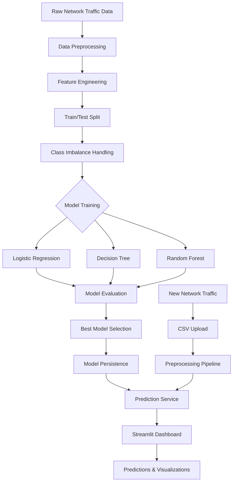

# 🛡️ ML-Based Intrusion Detection System (IDS)

[](https://www.python.org/downloads/)
[](LICENSE)
[]()

> **Machine Learning-Powered Network Intrusion Detection and Classification System**

A comprehensive cybersecurity solution leveraging machine learning algorithms to detect and classify network intrusions in real-time. Built as part of an internship project at CodeC Technologies.

---

## 📋 Table of Contents

- [Problem Statement](#-problem-statement)
- [Objectives](#-objectives)
- [Features](#-features)
- [Technology Stack](#-technology-stack)
- [System Architecture](#-system-architecture)
- [Dataset](#-dataset)
- [Installation](#-installation)
- [Usage](#-usage)
- [Project Structure](#-project-structure)
- [Machine Learning Models](#-machine-learning-models)
- [Evaluation Metrics](#-evaluation-metrics)
- [Screenshots](#-screenshots)
- [Testing](#-testing)
- [Limitations](#-limitations)
- [Future Enhancements](#-future-enhancements)
- [Ethical Considerations](#-ethical-considerations)
- [Contributing](#-contributing)
- [License](#-license)
- [Author](#-author)

---

## 🎯 Problem Statement

With the exponential growth of network traffic and increasingly sophisticated cyber attacks, traditional signature-based intrusion detection systems struggle to identify novel threats. This project addresses the need for an intelligent, adaptive intrusion detection system that can:

- **Detect** known and unknown network intrusions
- **Classify** different types of cyber attacks
- **Adapt** to evolving threat patterns using machine learning
- **Provide** real-time analysis and actionable insights

---

## 🎯 Objectives

1. Develop a machine learning-based intrusion detection system capable of binary classification (benign vs. malicious)
2. Implement multi-class classification to identify specific attack types
3. Compare multiple ML algorithms (Logistic Regression, Decision Tree, Random Forest)
4. Build an interactive dashboard for real-time traffic analysis
5. Handle class imbalance in cybersecurity datasets
6. Provide comprehensive evaluation metrics and visualization
7. Create a production-ready, reproducible ML pipeline

---

## ✨ Features

### Core Functionality
- ✅ **Binary Classification**: Detect malicious vs. benign traffic
- ✅ **Multi-class Classification**: Identify specific attack types (DoS, DDoS, Port Scan, etc.)
- ✅ **CSV Upload Analysis**: Batch processing of network traffic data
- ⏳ **Live Network Monitoring**: Real-time packet capture (optional, disabled by default)

### Machine Learning
- 🤖 Multiple ML models: Logistic Regression, Decision Tree, Random Forest
- 📊 Comprehensive evaluation metrics
- 🎯 Class imbalance handling (SMOTE, undersampling)
- 🔍 Feature importance analysis
- 💾 Model persistence and versioning

### Dashboard
- 📈 Interactive Streamlit web interface
- 🎨 Cybersecurity-themed UI with dark mode
- 📊 Real-time visualizations with Plotly
- 📜 Prediction history tracking
- 🔐 Secure file upload with validation

### Security & Quality
- 🛡️ Input validation and sanitization
- 📝 Comprehensive logging
- ✅ Unit and integration tests
- 🔒 Safe defaults for network monitoring
- 📚 Complete documentation

---

## 🔧 Technology Stack

### Core Technologies
| Category | Technologies |
|----------|-------------|
| **Language** | Python 3.8+ |
| **ML Framework** | Scikit-learn |
| **Data Processing** | Pandas, NumPy |
| **Web Framework** | Streamlit |
| **Visualization** | Plotly, Matplotlib, Seaborn |
| **Model Persistence** | Joblib |
| **Testing** | Pytest |

### Key Libraries
```
numpy==1.26.4
pandas==2.1.4
scikit-learn==1.4.0
streamlit==1.29.0
plotly==5.18.0
imbalanced-learn==0.12.0
loguru==0.7.2
pytest==7.4.3
```

---

## 🏗️ System Architecture



### Data Flow
1. **Data Ingestion**: Load CIC-IDS2017 dataset or user-uploaded CSV
2. **Preprocessing**: Handle missing values, normalize features, encode labels
3. **Feature Engineering**: Scale features, select important features
4. **Model Training**: Train multiple ML models with cross-validation
5. **Evaluation**: Calculate metrics (accuracy, precision, recall, F1, ROC-AUC)
6. **Deployment**: Save best model and serve via Streamlit dashboard
7. **Prediction**: Classify new network traffic and display results

---

## 📊 Dataset

### CIC-IDS2017 Dataset

**Source**: [Canadian Institute for Cybersecurity](https://www.unb.ca/cic/datasets/ids-2017.html)

**Description**: A realistic intrusion detection dataset containing network traffic for normal activity and various cyber attacks.

**Statistics**:
- **Total Records**: ~2.8 million network flows
- **Time Period**: July 3-7, 2017
- **Attack Categories**: 14 different types
- **Features**: 78 network flow features

### Attack Categories

| Category | Description | Count |
|----------|-------------|-------|
| BENIGN | Normal network traffic | Majority class |
| DoS Hulk | Denial of Service attack | High |
| PortScan | Network port scanning | Medium |
| DDoS | Distributed Denial of Service | High |
| DoS GoldenEye | DoS using GoldenEye tool | Medium |
| FTP-Patator | FTP brute force attack | Low |
| SSH-Patator | SSH brute force attack | Low |
| DoS Slowloris | Slowloris DoS attack | Low |
| DoS Slowhttptest | Slow HTTP DoS attack | Low |
| Bot | Botnet traffic | Low |
| Web Attack – Brute Force | Web brute force | Very Low |
| Web Attack – XSS | Cross-site scripting | Very Low |
| Infiltration | Network infiltration | Very Low |
| Web Attack – SQL Injection | SQL injection attack | Very Low |
| Heartbleed | Heartbleed vulnerability exploit | Very Low |

### Download Instructions

1. Visit the [CIC-IDS2017 dataset page](https://www.unb.ca/cic/datasets/ids-2017.html)
2. Download the CSV files (recommended: Monday-Friday files)
3. Place downloaded files in `data/raw/` directory
4. Run preprocessing script (see Usage section)

**Note**: Dataset is ~8GB compressed. Ensure sufficient disk space.

---

## 🚀 Installation

### Prerequisites
- Python 3.8 or higher
- pip package manager
- Git
- 10GB+ free disk space (for dataset)

### Windows Setup (PowerShell)

1. **Clone the repository**
```powershell
git clone https://github.com/mahakyadav13-code/ML-Based-Intrusion-Detection-System.git
cd ML-Based-Intrusion-Detection-System
```

2. **Create virtual environment**
```powershell
python -m venv .venv
.\.venv\Scripts\Activate.ps1
```

3. **Upgrade pip**
```powershell
python -m pip install --upgrade pip
```

4. **Install dependencies**
```powershell
pip install -r requirements.txt
```

5. **Verify installation**
```powershell
python -c "import sklearn, pandas, streamlit; print('✓ All dependencies installed')"
```

---

## 📖 Usage

### Step 1: Prepare Dataset

Download CIC-IDS2017 dataset and place in `data/raw/`

### Step 2: Data Preprocessing

```powershell
# Preprocess raw data
python src/data_preprocessing.py
```

### Step 3: Train Models

```powershell
# Train all models
python src/train_model.py
```

### Step 4: Evaluate Models

```powershell
# Evaluate and compare models
python src/evaluate_model.py
```

### Step 5: Launch Dashboard

```powershell
# Start Streamlit application
streamlit run app.py
```

The dashboard will open in your default browser at `http://localhost:8501`

### Step 6: Make Predictions

1. Navigate to "🛡️ Intrusion Detection" in the sidebar
2. Upload a CSV file with network traffic features
3. View predictions and confidence scores
4. Download results as CSV

---

## 📁 Project Structure

```
ML-Based-Intrusion-Detection-System/
├── app.py                          # Main Streamlit application
├── config.py                       # Configuration settings
├── requirements.txt                # Python dependencies
├── README.md                       # Project documentation
├── LICENSE                         # MIT License
├── .gitignore                      # Git ignore rules
├── data/                           # Dataset directory
│   ├── raw/                        # Raw CIC-IDS2017 data
│   ├── processed/                  # Processed data
│   └── sample/                     # Sample data for testing
├── models/                         # Saved models
│   ├── ids_model.joblib           # Trained model
│   ├── model_metadata.json        # Model metadata
│   ├── feature_names.json         # Feature list
│   └── scaler.joblib              # Feature scaler
├── src/                           # Source code
│   ├── __init__.py
│   ├── utils.py                   # Utility functions
│   ├── data_preprocessing.py      # Data preprocessing
│   ├── feature_engineering.py     # Feature engineering
│   ├── train_model.py             # Model training
│   ├── evaluate_model.py          # Model evaluation
│   └── predict.py                 # Prediction utilities
├── dashboard/                     # Dashboard components
│   ├── __init__.py
│   ├── overview.py                # Overview page
│   ├── traffic_analysis.py        # Traffic analysis
│   └── model_performance.py       # Performance metrics
├── tests/                         # Test suite
│   ├── __init__.py
│   ├── test_preprocessing.py      # Preprocessing tests
│   ├── test_prediction.py         # Prediction tests
│   └── test_model.py              # Model tests
├── configs/                       # Configuration files
├── logs/                          # Application logs
├── reports/                       # Evaluation reports
├── assets/                        # Static assets
├── notebooks/                     # Jupyter notebooks
└── scripts/                       # Utility scripts
```

---

## 🤖 Machine Learning Models

### 1. Logistic Regression
**Purpose**: Baseline linear model  
**Strengths**: Fast, interpretable, probabilistic outputs  
**Use Case**: Quick detection with explainable results

### 2. Decision Tree Classifier
**Purpose**: Non-linear pattern detection  
**Strengths**: Handles non-linear relationships, feature importance  
**Use Case**: Understanding decision boundaries

### 3. Random Forest Classifier
**Purpose**: Ensemble method for robust predictions  
**Strengths**: High accuracy, handles overfitting, feature importance  
**Use Case**: Production deployment (best performance)

### Model Training Pipeline

1. **Data Splitting**: 70% train, 30% test (stratified)
2. **Preprocessing**: Standardization, encoding
3. **Class Imbalance**: SMOTE + undersampling
4. **Cross-Validation**: 5-fold stratified CV
5. **Hyperparameter Tuning**: Grid search (optional)
6. **Model Selection**: Based on F1-score and recall

---

## 📊 Evaluation Metrics

### Binary Classification Metrics

| Metric | Description | Importance |
|--------|-------------|------------|
| **Accuracy** | Overall correctness | Baseline measure |
| **Precision** | True positives / Predicted positives | Minimize false alarms |
| **Recall** | True positives / Actual positives | **Critical** - catch attacks |
| **F1-Score** | Harmonic mean of precision/recall | Balance measure |
| **ROC-AUC** | Area under ROC curve | Threshold-independent |

### Multi-class Metrics

- **Macro-averaged** metrics (treat all classes equally)
- **Weighted-averaged** metrics (account for class imbalance)
- **Per-class** precision, recall, F1-score
- **Confusion Matrix** visualization

### Why Recall Matters in IDS

In intrusion detection:
- **False Negative (missed attack)** → Security breach ⚠️
- **False Positive (false alarm)** → Inconvenience ⚠️

**Conclusion**: Prioritize recall to minimize missed attacks, while maintaining reasonable precision.

---

## 📸 Screenshots

> Screenshots will be added after implementation

### Dashboard Overview
*Coming soon*

### Traffic Analysis
*Coming soon*

### Model Performance
*Coming soon*

### Prediction Results
*Coming soon*

---

## 🧪 Testing

### Run All Tests

```powershell
# Run test suite
python -m pytest tests/ -v

# Run with coverage
python -m pytest tests/ --cov=src --cov-report=html

# Run specific test file
python -m pytest tests/test_preprocessing.py -v
```

### Test Categories

1. **Unit Tests**: Individual functions and components
2. **Integration Tests**: End-to-end workflows
3. **Data Validation Tests**: Input validation and edge cases

### Test Coverage Goal

- Minimum 80% code coverage
- All critical paths tested
- Edge cases and error conditions covered

---

## ⚠️ Limitations

### Current Limitations

1. **Dataset Dependency**: Requires CIC-IDS2017 dataset for training
2. **Feature Schema**: Input data must match training feature schema exactly
3. **Static Model**: Model requires retraining for new attack types
4. **Performance**: Large CSV files may require significant processing time
5. **Live Monitoring**: Optional feature requires administrative privileges

### Known Issues

- [ ] Live packet capture not fully compatible with all network interfaces
- [ ] Large datasets (>1M rows) may cause memory issues
- [ ] Model retraining not automated

### Not Included

- Production-grade deployment (Docker, Kubernetes)
- Real-time alerting and notifications
- Integration with SIEM systems
- Automated model retraining pipeline
- API for external integration

---

## 🚀 Future Enhancements

### Short-term (Next Release)

- [ ] REST API for predictions (FastAPI)
- [ ] Enhanced visualizations (3D plots, animations)
- [ ] Automated hyperparameter tuning
- [ ] Model comparison dashboard
- [ ] Export reports to PDF

### Medium-term

- [ ] Deep learning models (LSTM, CNN)
- [ ] Explainable AI (SHAP, LIME)
- [ ] Real-time alerting system
- [ ] Multi-dataset support (UNSW-NB15, NSL-KDD)
- [ ] Automated feature selection

### Long-term

- [ ] Distributed training for large datasets
- [ ] Online learning / incremental training
- [ ] Integration with network security tools
- [ ] Mobile application
- [ ] Blockchain-based threat intelligence sharing

---

## ⚖️ Ethical Considerations

### Intended Use

This system is designed for:
- ✅ Educational purposes and learning
- ✅ Authorized network security monitoring
- ✅ Cybersecurity research
- ✅ Defense and protection of owned systems

### Prohibited Use

**DO NOT use this system for**:
- ❌ Unauthorized network access or monitoring
- ❌ Hacking or penetration testing without permission
- ❌ Privacy violations or data theft
- ❌ Malicious activities of any kind

### Privacy & Compliance

- Only monitor networks you own or have explicit authorization to monitor
- Comply with local laws and regulations (GDPR, CCPA, etc.)
- Do not capture, store, or analyze sensitive personal data
- Implement proper data retention and deletion policies

### Responsible Disclosure

If you discover security vulnerabilities in this system:
1. Do not exploit the vulnerability
2. Report it privately to the maintainer
3. Allow reasonable time for fixes before public disclosure

---

## 🤝 Contributing

Contributions are welcome! Please follow these guidelines:

### How to Contribute

1. Fork the repository
2. Create a feature branch (`git checkout -b feature/AmazingFeature`)
3. Commit your changes (`git commit -m 'Add some AmazingFeature'`)
4. Push to the branch (`git push origin feature/AmazingFeature`)
5. Open a Pull Request

### Code Style

- Follow PEP 8 style guidelines
- Add docstrings to all functions
- Include type hints where appropriate
- Write unit tests for new features

### Reporting Issues

Use GitHub Issues to report:
- Bugs and errors
- Feature requests
- Documentation improvements

---

## 📄 License

This project is licensed under the **MIT License** - see the [LICENSE](LICENSE) file for details.

### Disclaimer

This software is provided "as is" without warranty of any kind. The authors are not responsible for any misuse or damage caused by this software. Use at your own risk and only on networks you are authorized to monitor.

---

## 👤 Author

**Mahak Yadav**

- GitHub: [@mahakyadav13-code](https://github.com/mahakyadav13-code)
- Email: mahakyadav1309@gmail.com
- LinkedIn: [Connect with me](https://linkedin.com/in/mahakyadav)

### Organization

**CodeC Technologies** - Internship Project

---

## 🙏 Acknowledgments

- Canadian Institute for Cybersecurity for the CIC-IDS2017 dataset
- Scikit-learn community for excellent ML tools
- Streamlit team for the amazing web framework
- CodeC Technologies for the internship opportunity

---

## 📚 References

1. Sharafaldin, I., Lashkari, A.H., & Ghorbani, A.A. (2018). Toward Generating a New Intrusion Detection Dataset and Intrusion Traffic Characterization. ICISSp.
2. [CIC-IDS2017 Dataset](https://www.unb.ca/cic/datasets/ids-2017.html)
3. [Scikit-learn Documentation](https://scikit-learn.org/)
4. [Streamlit Documentation](https://docs.streamlit.io/)

---

<div align="center">

**⭐ Star this repo if you find it helpful! ⭐**

Built with ❤️ for Cybersecurity

</div>
